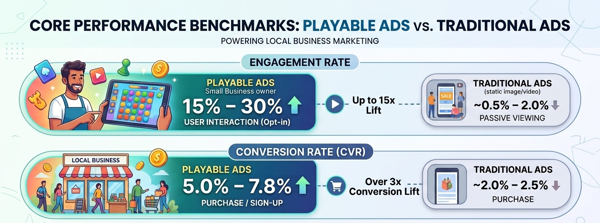
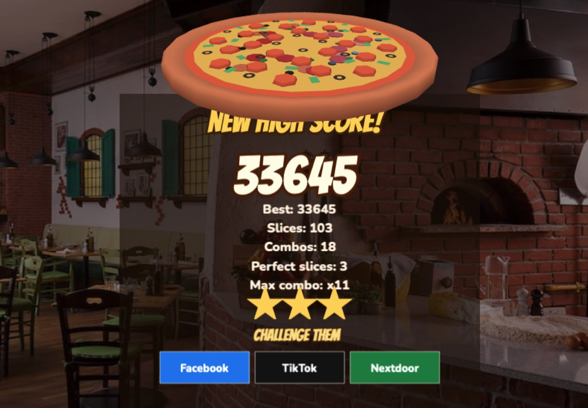
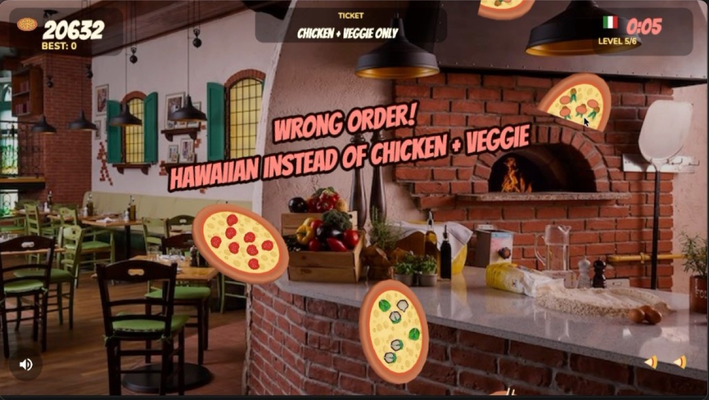

# Beach Dog Marketing — Make your customers the campaign

Beach Dog Marketing helps local businesses grow with playful, high-converting marketing experiences.

## Navigation

- [Beach Dog Marketing](#top)
- [Solutions](#solutions)
- [How it works](#how-it-works)
- [Results](#results)
- [Book a demo](#contact)

## Hero

Viral marketing that plays to win

### Make your customers the campaign.

We help local businesses turn passive scrollers into loyal regulars with playful, high-converting marketing experiences.

- [Launch a campaign](#contact)
- [See it in action](#demo)

Built for the businesses people root for.

## Live campaign

Your next regular is here

Live campaign

## Sunset Sips Showdown

Live

Daily speed run · 00:14:22

**Before play:** GO

Tap to see how fast your customers play.

**After play:** 42

Nice! You just earned 840 points.

Top players today · [View all](#demo)

1. Maya R. — 12,480 pts
2. The Coffee Club — 11,920 pts
3. Jake’s Bikes — 9,840 pts

Players today

**2,841** +18%

## Use cases

Key use cases for small businesses.

1. **Local Restaurants & Retail.** Interactive scratch-and-win coupon codes or spin-wheel discounts integrated into Meta/Instagram ads.
2. **Lead Generation & Services.** Interactive quizzes (e.g., “Which flooring suits your house?”) that capture user information upon completion.
3. **Local Commerce.** Mini-games offering a promo code at the end to drive local foot traffic or web orders.

## Playables offer big advantages for non-gaming companies.

For a small business, the best distribution platform for reaching their customers is viral social media that users voluntarily interact and engage to achieve high score unlocked promotional discounts. This means your barrier to advertising is zero cost.

### Increased Engagement

Playable ads are 32% more memorable compared to video and static ads, and have 47% longer attention compared to video ads. By providing an interactive and immersive experience, playable ads create excitement and curiosity, which leads to higher engagement rates and more time spent interacting.

### Better Conversion Rates

Playable ads have 3 times higher conversion rates than traditional video ads, and are 46% more effective compared to other ads. By allowing users to experience a brand’s product or service firsthand, playable ads can help to build trust and confidence in the brand. This can make users more likely to make a purchase or take some other desired action.

## Campaign deliverables.

1. **Custom Interactive Build.** Design and technical setup of a branded HTML5 playable ad experience (mobile-optimized).
2. **Lead-Capture Integration.** High-converting end card with automated SMS/Email coupon delivery (via Mailchimp, Klaviyo, or Zapier).
3. **Ad Campaign Management.** Targeting, setup, and optimization across Nextdoor, Meta (Facebook/Instagram) and TikTok.
4. **Performance Tracking.** Real-time analytics dashboard monitoring plays, opt-ins, and redemption metrics.

## Results

- **+300%** engagement rate
- **−40%** customer acquisition cost
- **4.2×** more social shares

## The playbook

Your best marketing should feel like a game.

Static promotions get ignored. We build interactive campaigns that give people a reason to come back, bring friends, and buy now.

[Find your growth engine](#contact)

1. **Viral acquisition loops** — Dynamic leaderboard. Turn discounts into earned status. Every move gives customers a reason to share, return, and bring a friend.
2. **High-LTV retention engines** — King of the hill. Keep your best customers engaged and buying daily to protect their perks and their place at the top.
3. **Flash conversion boosters** — Speed runs. Turn abandoned carts into instant purchases with high-urgency, skill-based discounts.
4. **Community amplifiers** — Bracket tournaments. Leverage your customers’ networks to bring in thousands of new leads without extra ad spend.

## Why playables

\* Sources: Metrics compiled from industry benchmarks by [AppSamurai](https://appsamurai.com/blog/creating-playable-ads/), [Playable Factory](https://playablefactory.com/blog/importance-of-playable-ads-for-non-gaming-companies), and [WordStream Industry Benchmarks](https://www.wordstream.com/blog/ws/2023/04/03/google-ads-benchmarks). Engagement is measured as opt-in interactive engagement (15+ seconds) vs. standard static display interactions.

## The ripple effect

Small plays. Big waves.

A 30-second daily challenge can create a week of social momentum for your business.

1. **Capture attention.** Give people something fun to do, not another discount to ignore.
2. **Reward the return.** Turn every visit into progress, status, and a reason to come back tomorrow.
3. **Let it travel.** Players share their score. Their friends join. Your reach compounds.

## Live playable

Five levels. One high score.

Pizza Slice turns a swipe into a monthly promotion. Players climb five levels, chase the best score, and challenge friends on the channels they already use.

[Play Pizza Slice](https://beachdogs.github.io/playables/pizza-slice/)

Pizza Slice gameplay: [video](public/pizza-slice-gameplay.mov)

1. **Prep the toppings.** Slice flying ingredients. No whole pies yet.
2. **Slice the pies.** Cheese, pepperoni, Hawaiian, and a rare golden pie.
3. **Ticket time.** Only the order on the ticket scores.
4. **Multi-slice.** Three swipes break a pie into six pieces.
5. **Oven’s hot.** Dodge the burnt pies. Then the dinner rush crowns the score.

### This month’s board

1. Maya R. — 18,420
2. You — 12,480
3. Jake’s Bikes — 9,110

Share a score. Friends jump in to knock it off the board and claim the monthly promo.

## Ready when you are

Let’s make some waves.

Tell us where you want to grow and we’ll send over a few campaign ideas made for your business.

Your email address

[Get ideas](#contact)

You’re on the list. We’ll be in touch soon.

## Footer

© 2026 Beach Dog Marketing

Made for local businesses with big energy.
